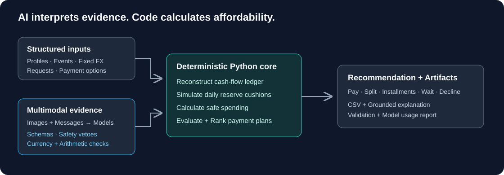

<div align="center">

# Cashflow Guard

### Can you afford it today—and still cover what comes next?

An AI-powered affordability agent that combines multimodal evidence extraction with deterministic cash-flow forecasting.

**HackerRank Orchestrate · September 2026**  
**Ranked #65 out of 3,062 participants globally · Top 2.2%**

[Quick start](#quick-start) · [Architecture](#how-it-works) · [Example](#try-it-without-an-api-key) · [Tests](#verification) · [Limitations](docs/limitations.md)

</div>

---

## Why this exists

A bank balance is a snapshot. Affordability depends on timing: rent due before payday, pending debits, essential expenses, and the cash buffer someone wants to keep.

Cashflow Guard evaluates a purchase against a projected 90-day cash-flow timeline. It recommends a full payment, a partial-payment schedule, an available installment option, waiting, or not proceeding. Each request is evaluated independently against the supplied financial context.

**The design principle: AI interprets evidence; deterministic code calculates affordability.**

Built by [Priyanshu Gupta](https://github.com/priy-anshugupta) during the 24-hour **HackerRank Orchestrate: Buy or Wait?** challenge. The rank above is the author's reported competition result, not a model accuracy score.

## What it handles

| Capability | Implementation |
|---|---|
| Financial context | Typed profiles, transactions, commitments, preferences, and seller payment options |
| Document evidence | Vision extraction of amounts from payslips, invoices, and receipts, with schema and arithmetic checks |
| Message interpretation | Structured cash-flow effects with deterministic vetoes for suspicious instructions |
| Cash-flow forecasting | Daily balance simulation with debits applied before same-day credits |
| Spending safety | Minimum projected cushion, capped by the requested amount |
| Payment planning | Candidate schedules, preference checks, simulation, and deterministic ranking |
| Currency handling | Supplied dated exchange rates; no live banking or market calls |
| Audit artifacts | Eight-column CSV output and a model usage report |

## How it works



1. **Load and validate.** Join records by user, request, and event identifiers; sanitize untrusted text.
2. **Extract evidence.** Read document amounts and classify relevant messages using configurable models. Validate the returned structure before it can affect the ledger.
3. **Reconstruct state.** Resolve cash states and amendments, reserve pending debits, infer supported recurrence, and normalize currencies.
4. **Simulate and plan.** Project daily balances, calculate the amount safe today, evaluate payment candidates, and rank them.
5. **Explain and export.** Produce grounded explanations, validate the output structure, and record model usage.

For an immediate payment, the core calculation is:

```text
safe_today = round(max(0, min(requested_amount, minimum_projected_cushion)), 2)
minimum_projected_cushion = min(projected_intraday_balance - required_reserve)
```

The current implementation computes this directly from the simulated cushion. It does not use binary search. See [architecture](docs/architecture.md) and [decision policy](docs/decision-policy.md) for implementation details and caveats.

## Quick start

Requires **Python 3.10+**. Local verification used Python 3.13; CI is configured for 3.11 and 3.13.

```bash
git clone https://github.com/priy-anshugupta/Cashflow---Guard.git
cd Cashflow---Guard
python -m venv .venv
```

Activate the environment:

```powershell
# Windows PowerShell
.venv\Scripts\Activate.ps1
```

```bash
# macOS / Linux
source .venv/bin/activate
```

```bash
python -m pip install -r code/requirements.txt
```

Copy `.env.example` to `.env` and set your own `OPENAI_API_KEY`. You can change `VISION_MODEL` and `NLP_MODEL` to models available to your account. The defaults reflect the submitted implementation. Model access and API charges depend on your account.

The full pipeline reads the challenge files in `dataset/`, including images. See the [data contract](docs/data-contract.md) for required files.

```bash
# Evaluate all requests
python code/main.py

# Evaluate the solved samples
python code/main.py --sample --report evaluation/sample_usage_report.md

# Require fresh model evidence rather than cached extraction
python code/main.py --require-live
```

Without a key, a full run requires previously validated OCR cache entries. A fresh clone does not include the private local cache. Use the standalone example below to explore the deterministic core without model access.

**Output behavior:** a full run writes root-level `output.csv` and mirrors it to `dataset/output.csv`. It also writes `evaluation/usage_report.md`. Sample mode writes `sample_output.csv`; use a separate `--report` path to preserve the submitted report.

## Try it without an API key

After installing the dependencies:

```bash
python examples/safe_spending.py
```

The example uses synthetic figures: balance **3,000**, minimum reserve **1,000**, rent of **1,200** before confirmed salary of **2,000**, and a requested purchase of **1,500**.

```text
Requested: 1500.00
Safe to pay today: 800.00
Full payment today preserves reserve: False
Lowest balance after full payment: 300.00
```

The upcoming salary does not remove the earlier cash shortfall. This example demonstrates the simulator and safe-amount calculation; it does not run the complete recommendation pipeline.

## Output contract

Every evaluation request produces one row with these columns:

```csv
request_id,amount_safe_to_pay,affordability_status,recommended_payment_method,payment_plan,earliest_date_for_full_payment,spending_changes_needed,decision_explanation
```

| Field | Meaning |
|---|---|
| `amount_safe_to_pay` | Amount safe on the request date before optional spending changes |
| `affordability_status` | `affordable_now`, `affordable_with_plan`, `affordable_later`, or `not_affordable` |
| `recommended_payment_method` | `full_payment`, `partial_payment`, `installments`, `wait`, or `not_recommended` |
| `payment_plan` | Dated payments separated by `\|`, or `none` |
| `earliest_date_for_full_payment` | Projected date for a single full payment, or empty |
| `spending_changes_needed` | Up to three permitted changes, or `none` |
| `decision_explanation` | Concise explanation tied to financial context |

See the [original problem statement](problem_statement.md) for the complete challenge contract. Schema validation does not establish financial correctness; [known limitations](docs/limitations.md) describe the practical boundaries.

## Verification

```bash
python -m pytest
python -m compileall -q code examples
python examples/safe_spending.py
```

The default pytest selection runs the **12 guardrail regression tests**, covering message injection detection, model schemas, OCR consistency, currency parsing, deterministic isolation, spending changes, and expense cushions. These checks passed locally during portfolio preparation. They do not measure hidden evaluation accuracy.

GitHub Actions is configured to run these checks on Python 3.11 and 3.13. Historical scripts that may load datasets or make model calls remain available explicitly; see the [testing guide](docs/testing.md).

## Recorded challenge run

The supplied [usage report](evaluation/usage_report.md) records the September 13, 2026 run:

| Metric | Recorded value |
|---|---:|
| Evaluation requests | 250 |
| Model calls | 25 |
| Input tokens | 41,568 |
| Output tokens | 10,965 |
| Total tokens | 52,533 |
| Average tokens per request | 210.1 |
| Estimated model cost | US$0.2684 |
| Elapsed pipeline time | 121.18 seconds |

These are historical artifact values, not measurements from the portfolio checks or current pricing. They have not been independently re-run here. See [reproducibility](docs/reproducibility.md) for cache behavior and cost-report assumptions.

## Repository map

```text
Cashflow---Guard/
├── code/
│   ├── main.py                 # CLI and orchestration
│   ├── config.py               # Paths and model configuration
│   ├── data/                   # Models, loaders, and joins
│   ├── extraction/             # Vision, messages, currency, cache
│   ├── engine/                 # Ledger, simulator, and payment planning
│   ├── output/                 # Deterministic explanations
│   └── tests/                  # Guardrails and historical experiments
├── dataset/                    # Organizer-provided challenge inputs
├── docs/                       # Design, policy, testing, limitations
├── examples/safe_spending.py    # Synthetic example without API calls
├── evaluation/usage_report.md   # Recorded challenge usage
├── output.csv                  # Existing challenge predictions
└── .github/workflows/checks.yml
```

## Scope and attribution

Cashflow Guard is a hackathon prototype for the supplied challenge data. It uses floating-point amounts, heuristics for recurrence and message interpretation, and external models for evidence extraction. Deterministic calculations can still contain software or modeling errors. It has no live bank integration and does not execute payments. Review the [limitations](docs/limitations.md) before adapting it.

The repository includes the challenge specification, dataset, and agent instructions from [HackerRank's starter repository](https://github.com/interviewstreet/hackerrank-orchestrate-september26). The implementation and portfolio documentation are presented as Priyanshu Gupta's challenge project. The published Git history contains the 50 project commits; the organizer's earlier commits are excluded. No new license is asserted over organizer materials; see [provenance](docs/provenance.md).

[Contributing](CONTRIBUTING.md) · [Security boundaries](docs/security.md) · [Change notes](CHANGELOG.md)
